<picture>
  <source media="(prefers-color-scheme: dark)" srcset="assets/brand/hero-dark.svg">
  
</picture>

  <a href="https://heavyblanketpizza.github.io/chaos-to-model-overview/"><b>Watch the demos</b></a>
  &nbsp;·&nbsp;
  <a href="docs/how-it-works.md"><b>How it works</b></a>
  &nbsp;·&nbsp;
  <a href="docs/benchmarks.md"><b>Benchmarks</b></a>
  &nbsp;·&nbsp;
  <a href="docs/progress.md"><b>Progress</b></a>
  &nbsp;·&nbsp;
  <a href="#questions"><b>FAQ</b></a>

**Chaos-to-Model** (`c2m`) turns a folder of PDFs, scans, ebooks, office files and web pages into training data on one Apple Silicon Mac. Every row it exports keeps its source file, its page, the box on that page, and each step and model that touched it. You can trace a generated answer back to the passage it came from.

This repository is the public overview: the idea, the demos, how the work is going, and how c2m compares with **Unsloth Data Recipes** and **NVIDIA NeMo Curator** on the same files. The engine itself is private while it is in pilot.

## Watch it run

<a href="https://heavyblanketpizza.github.io/chaos-to-model-overview/#live">
  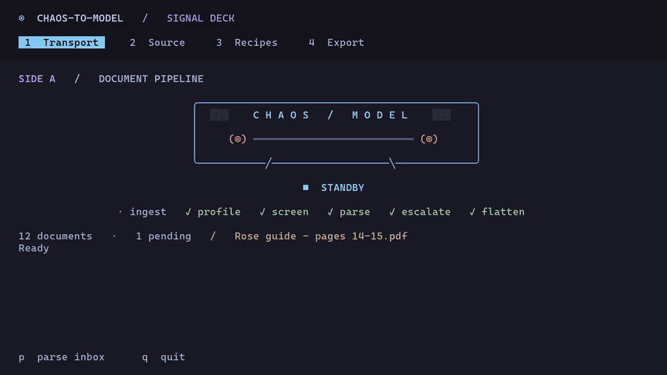
</a>

A recorded terminal session at 2×, in a demo console that drives the real engine. The parse, the table, its source box and the signature check are live output; the recipe comparison reads the recorded benchmark runs. Narrated version and full-length films on the <a href="https://heavyblanketpizza.github.io/chaos-to-model-overview/">demo page</a>.

## At a glance

<picture>
  <source media="(prefers-color-scheme: dark)" srcset="assets/charts/kpis-dark.svg">
  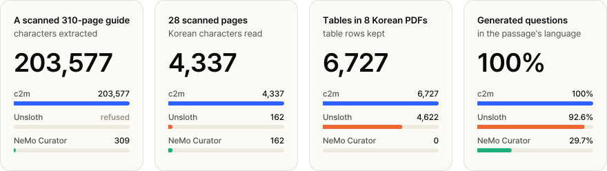
</picture>

Same 12 files for every pipeline, matched by SHA-256: eight Korean agricultural guides and four Project Gutenberg books. Same local teacher model. Counts describe extracted output, not accuracy. Setup, caveats and every number: <a href="docs/benchmarks.md">docs/benchmarks.md</a>.

## Why this exists

Open-weight models are easy to get. Training data made from a team's own documents is not. The material is a folder of PDFs, scans and manuals that often cannot leave the building, and the damage happens quietly during extraction:

- A Korean word split across two printed lines becomes two words.
- A table becomes a stream of loose numbers, or a measurement is mistaken for a phone number and redacted.
- Two editions of one book land on both sides of the train/test split, and the evaluation looks better than it is.
- Nobody can say which page a bad training example came from, or whether the dataset taught the model anything.

c2m makes that path one local workflow: read the documents faithfully, apply the team's rules about what may be used, keep a trace for every row, and measure what the result teaches a model.

## How it works

<picture>
  <source media="(prefers-color-scheme: dark)" srcset="assets/charts/pipeline-dark.svg">
  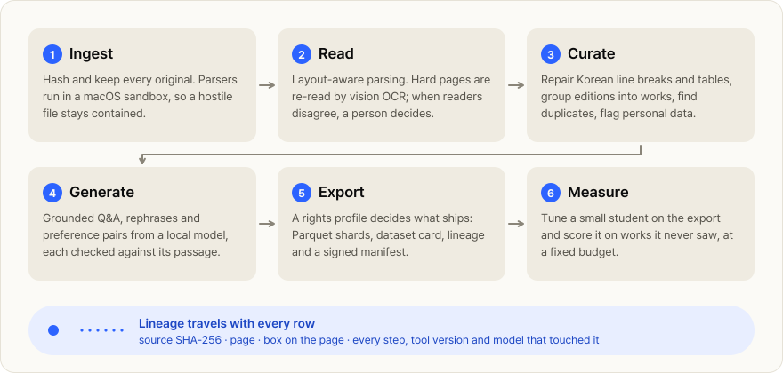
</picture>

<table>
  <tr>
    <td width="50%" valign="top">
      <a href="https://heavyblanketpizza.github.io/chaos-to-model-overview/#concept">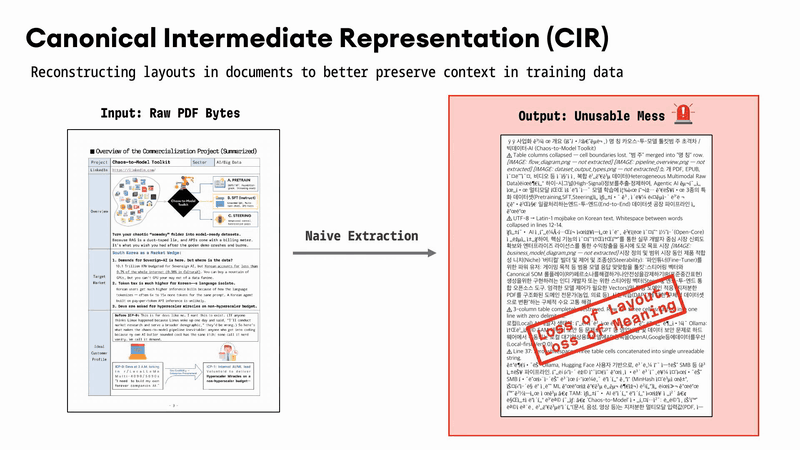</a>
       <b>The problem.</b> Text pulled straight from PDF bytes loses layout and meaning.
    </td>
    <td width="50%" valign="top">
      <a href="https://heavyblanketpizza.github.io/chaos-to-model-overview/#concept">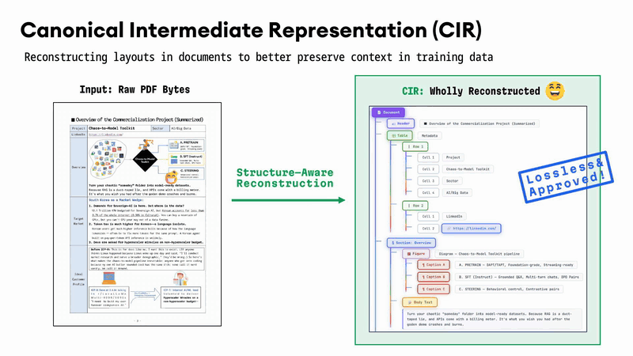</a>
       <b>Structure-aware reading.</b> Headings, sections and tables survive. <code>shipped</code>
    </td>
  </tr>
  <tr>
    <td width="50%" valign="top">
      <a href="https://heavyblanketpizza.github.io/chaos-to-model-overview/#concept">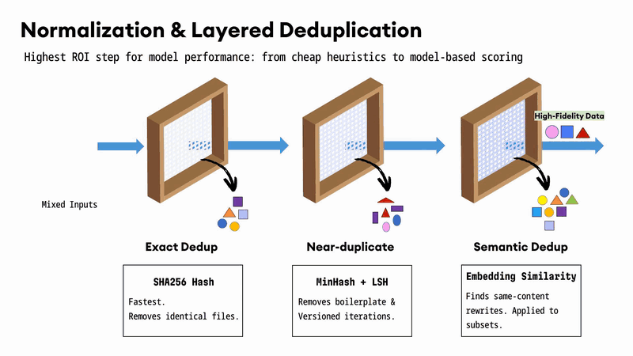</a>
       <b>Layered deduplication.</b> Exact and near-duplicate layers <code>shipped</code>; semantic layer <code>roadmap</code>
    </td>
    <td width="50%" valign="top">
      <a href="https://heavyblanketpizza.github.io/chaos-to-model-overview/#concept">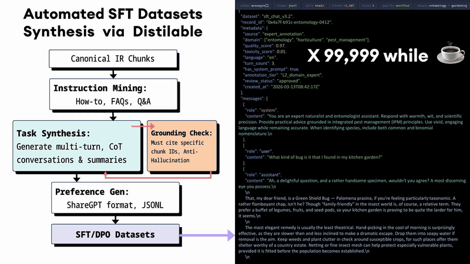</a>
       <b>Grounded synthesis.</b> Every generated example is checked against its passage. <code>shipped</code>
    </td>
  </tr>
</table>

All eleven concept animations, each marked shipped or roadmap, are in [docs/how-it-works.md](docs/how-it-works.md).

## Follow one number

<picture>
  <source media="(prefers-color-scheme: dark)" srcset="assets/charts/story-dark.svg">
  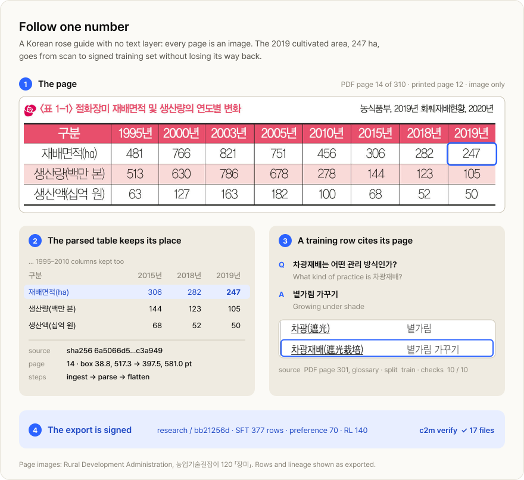
</picture>

## Benchmarks

Three pipelines read the same 12 files and generated training sets with the same local teacher, `Qwen3.8-27B` (4-bit, MLX). Unsloth ran its **PDF Document QA** recipe at a pinned Studio commit. NeMo Curator ran its **Nemotron-CC** recipes (DiverseQA and Wikipedia-style rephrasing) at v1.4.0. Every change from the upstream recipes is listed in [the report](docs/benchmarks.md#how-the-baselines-were-run).

<picture>
  <source media="(prefers-color-scheme: dark)" srcset="assets/charts/scans-dark.svg">
  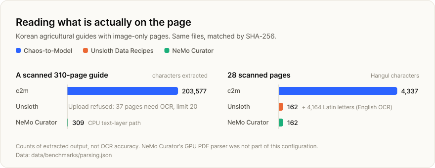
</picture>

<picture>
  <source media="(prefers-color-scheme: dark)" srcset="assets/charts/structure-dark.svg">
  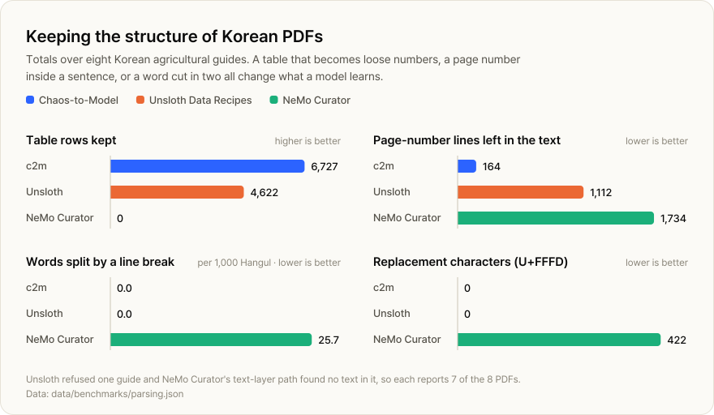
</picture>

<picture>
  <source media="(prefers-color-scheme: dark)" srcset="assets/charts/datasets-dark.svg">
  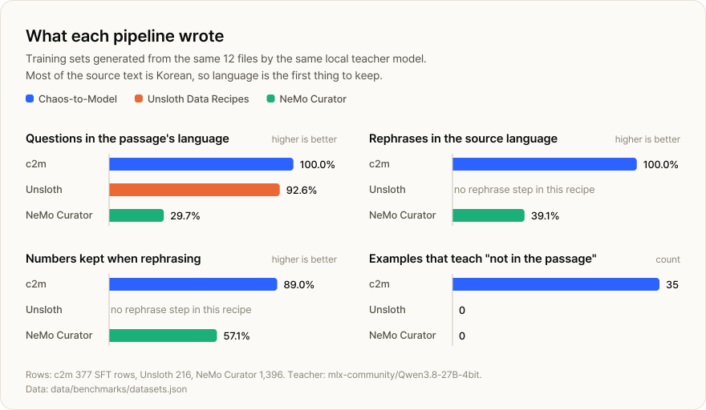
</picture>

### Does the data teach a model more?

A small student is tuned on each pipeline's set and asked about works it never saw, under a [protocol committed before any run](docs/protocol/c2m.folds-1.md). Results so far, reported as they came out:

<picture>
  <source media="(prefers-color-scheme: dark)" srcset="assets/charts/proxy-scores-dark.svg">
  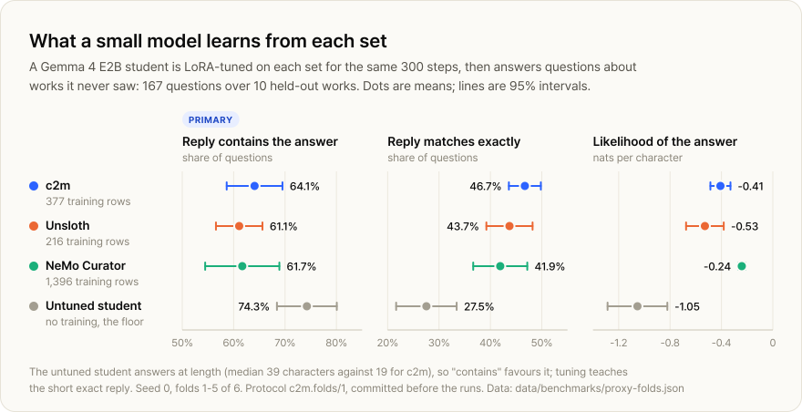
</picture>

- **Exact match:** the c2m-tuned student gives the exact answer most often, and the gap over NeMo Curator is outside the noise (**+4.8 points**, 95% interval +0.2 to +9.4). It did so from **377 rows against Curator's 1,396**.
- **Against Unsloth,** c2m leads on answer likelihood over all questions, and on exact match for the questions c2m wrote (**+5.2 points**, +1.5 to +9.0). Over all questions its exact-match lead (+3.0) is within the noise.
- **The primary score, "contains the answer", does not separate the three sets.** The untuned student scores highest on it because it answers at length; tuning teaches all three students to answer briefly.
- **NeMo Curator's students give the gold answer the highest likelihood**, clearly ahead of c2m on that score.
- **Format matters.** c2m's set includes 140 short-answer rows that ask for the same short copied reply as the evaluation; the baselines have none. An earlier single split (21 questions, 2 works), run before c2m added those rows, favoured Unsloth on exact match. Both are in the report.
- **Still to run:** fold 6 of 6, and seeds 1 and 2 of the robustness check. They will be added here whatever they show.

The paired differences, per question source, are in [the full report](docs/benchmarks.md#5-what-a-small-model-learns).

## Progress

<picture>
  <source media="(prefers-color-scheme: dark)" srcset="assets/charts/timeline-dark.svg">
  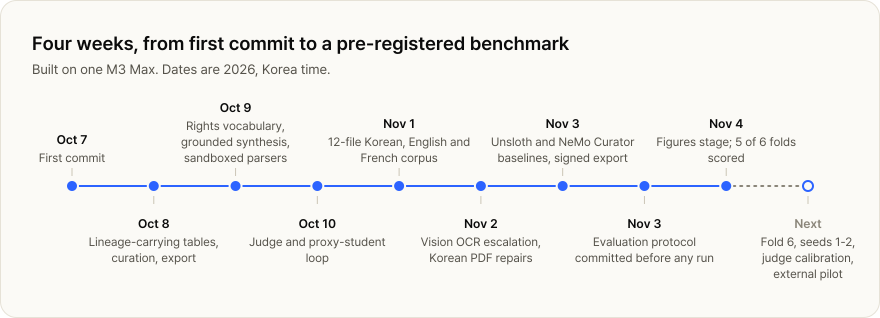
</picture>

| | Status on November 4, 2026 |
| --- | --- |
| **Engine** | Local Python library and CLI, about 25,500 lines, with about 1,050 tests. Runs are cached and resume where they stopped. |
| **Formats** | PDFs (text and scanned), EPUB, office files, web pages. Figures and charts become text. |
| **Languages tested** | Korean, English, French |
| **Outputs** | Pretraining text, SFT, preference and RL sets, token shards. Parquet with dataset cards, lineage and a signed manifest. |
| **Evaluation** | Proxy student on held-out works; cross-validated benchmark against two public recipes, 5 of 6 folds scored. |
| **Next** | Finish the benchmark, calibrate the judge against human labels, and run an external pilot on a customer's own documents. |

Shipped, in progress and roadmap, item by item: [docs/progress.md](docs/progress.md).

## What is public here

| In this repository | Kept private |
| --- | --- |
| The idea, the demos and the concept animations | Engine source code |
| Benchmark results as JSON and CSV in [`data/`](data/benchmarks) | Prompts, checks and thresholds |
| The evaluation protocol, byte for byte as committed | Configuration and model settings |
| The code that draws every chart, in [`tools/`](tools) | Customer and pilot documents |

Every chart is drawn from the files in `data/` by `tools/`; none is drawn by hand.

## Questions

<b>Does anything leave the machine?</b>

Parsing, OCR, generation, judging and training run on the Mac, with open-weight models served on loopback. The one networked feature, web lookup for document metadata, can be switched off; it is off in the benchmark runs.

<b>What does it run on?</b>

An Apple Silicon Mac. The benchmark and the films were made on one M3 Max.

<b>Why compare against Unsloth Data Recipes and NeMo Curator?</b>

They are the closest public tools for turning documents into training data, one aimed at individual developers and one at large-scale curation. Both were run as published, with the same teacher, the same files and the same generation budget per task. Where a recipe needed a change to run on this hardware, the change is recorded. NeMo Curator's GPU PDF parser and quality classifiers need an NVIDIA GPU and were not part of this configuration, so its PDF results describe its CPU text-layer path.

<b>Why Korean?</b>

Korean documents are where extraction mistakes are easiest to see and most expensive: line breaks inside words, mixed scripts, dense tables and scans without a text layer. The benchmark also includes English and French ebooks as clean-text controls: 99.9 to 100% of c2m's text from them also appears in each baseline's output.

<b>How do I try it?</b>

c2m is in a private pilot. If you have documents you need to train on and cannot upload, open an issue or get in touch through <a href="https://www.westofthesun.com">westofthesun.com</a>.

---

Built by Juha Chung at <a href="https://www.westofthesun.com">West of the Sun</a> (태양의서쪽), Korea. Rose and agricultural guide pages: Rural Development Administration (농촌진흥청), 농업기술길잡이 series, shown for comparison. Ebooks: Project Gutenberg. © 2026 West of the Sun.
