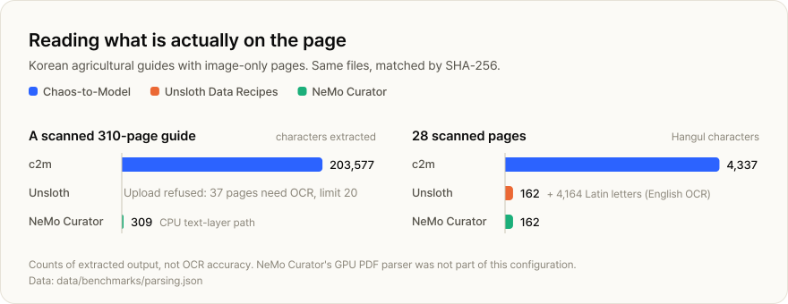
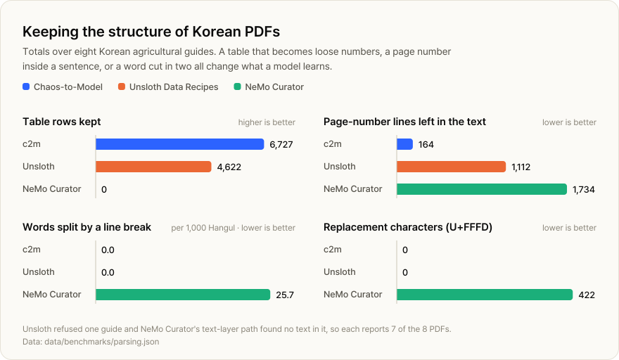
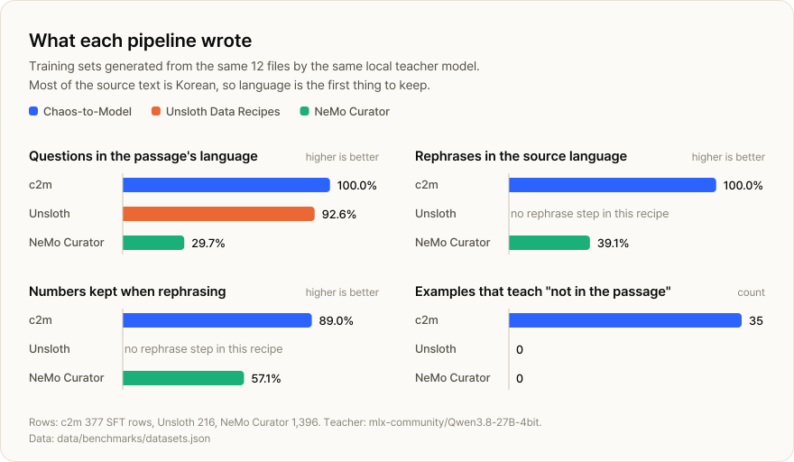
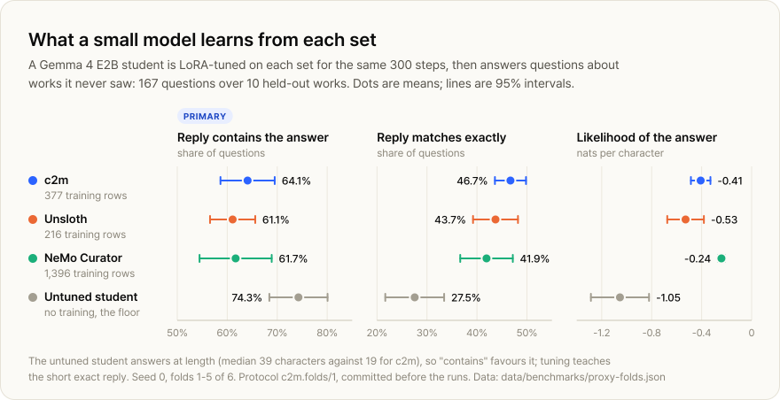
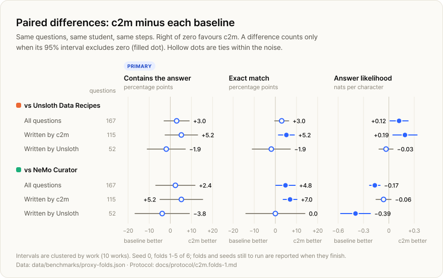

<a href="../README.md">Chaos-to-Model</a> / Benchmarks

# Benchmarks

c2m, **Unsloth Data Recipes** and **NVIDIA NeMo Curator** read the same 12 files and generated training sets with the same local teacher model. This page reports what each pipeline extracted, what it wrote, and what a small model learned from it, including the results that do not favour c2m.

**Contents:** [Summary](#summary) · [Setup](#setup) · [1. Scanned pages](#1-reading-scanned-pages) · [2. Structure](#2-keeping-structure) · [3. Clean-text controls](#3-clean-text-controls) · [4. Training sets](#4-what-each-pipeline-wrote) · [5. Model evaluation](#5-what-a-small-model-learns) · [Limits](#what-these-results-do-not-show) · [Data](#data-and-charts)

## Summary

| Measure | c2m | Unsloth | NeMo Curator | Scope |
| --- | ---: | ---: | ---: | --- |
| Characters extracted from a scanned guide | **203,577** | refused | 309 | 1 PDF, 310 image-only pages |
| Hangul read on scanned pages | **4,337** | 162 | 162 | 28 pages |
| Table rows kept | **6,727** | 4,622 | 0 | 8 Korean PDFs |
| Page-number lines left in the text | **164** | 1,112 | 1,734 | 8 Korean PDFs |
| Words split by a line break, per 1,000 Hangul | **0.0** | **0.0** | 25.7 | 8 Korean PDFs |
| Text agreement on clean ebooks | reference | 99.9–100% | 99.9–100% | 4 EPUBs |
| Questions in the passage's language | **100%** | 92.6% | 29.7% | QA sets |
| Student exact match on unseen works | **46.7%** | 43.7% | 41.9% | 167 questions, 10 works |
| Student "contains the answer" (primary) | 64.1% | 61.1% | 61.7% | no significant difference |
| Student answer likelihood, nats/char | −0.41 | −0.53 | **−0.24** | Curator ahead |

Bold marks the best value in a row. The last three rows come from a cross-validated evaluation that is still running: 5 of 6 folds and 1 of 3 seeds are done.

## Setup

### The corpus

Eight Korean agricultural guides published by Korea's Rural Development Administration (농촌진흥청), and four Project Gutenberg ebooks. Together they hold 3.28 million characters and 2,018 PDF pages. Korean makes up 1.41 million characters, English 1.55 million and French 0.29 million. One guide, *Roses*, has no text layer at all.

<b>All 12 files</b>

| File | Language | Format | SHA-256 |
| --- | --- | --- | --- |
| Greenhouse fruit growing 2023 농업기술길잡이 과수시설재배 | ko | PDF | `649705b11c49` |
| Home kitchen gardens 2023 농업기술길잡이 생활속 텃밭정원 | ko | PDF | `ddf21ce3df6f` |
| Pollinating bees 2023 농업기술길잡이 화분매개곤충 벌 | ko | PDF | `a95583eb31e3` |
| Tomato (low-resolution copy) 농업기술길잡이 29 토마토 | ko | PDF | `70a46a767fd4` |
| Beekeeping 농업기술길잡이 양봉 | ko | PDF | `f8beadcf0913` |
| Roses 농업기술길잡이 120 장미 | ko | PDF (scanned) | `6a5066d54fe4` |
| Figs 농업기술길잡이 214 무화과 | ko | PDF | `3df59afd78f8` |
| Olives 농업기술길잡이 219 올리브 | ko | PDF | `75369e865564` |
| Contes d'une grand-mère — George Sand Project Gutenberg #12338 | fr | EPUB | `7cceba75a71b` |
| Edmund Dulac's Fairy-Book Project Gutenberg #25513 | en | EPUB | `6e6bc9b0c6a4` |
| Quo Vadis — Henryk Sienkiewicz Project Gutenberg #2853 | en | EPUB | `3492163548a2` |
| A Vision of Venus — Otis Adelbert Kline Project Gutenberg #79886 | en | EPUB | `8509c4a7299c` |

Every pipeline's output is joined to these files by SHA-256.

### How the baselines were run

| | Unsloth Data Recipes | NeMo Curator |
| --- | --- | --- |
| Recipe | PDF Document QA (`pdf-grounded-qa`) | Nemotron-CC tutorial: DiverseQA and Wikipedia-style rephrasing |
| Version | Studio commit `b36f53d`, Data Designer 0.5.4 | NeMo Curator 1.4.0, Docker on Linux arm64 |
| Extraction | Studio's own upload path: PyMuPDF text, Tesseract OCR for pages without text (English by default, 20-page limit per upload) | pypdfium2 text layer for PDFs, BeautifulSoup for EPUBs. Curator's own PDF reader needs an NVIDIA GPU. |
| Budget | 216 QA rows | 216 DiverseQA segments (each yields several pairs) and 48 rephrase segments, sampled with seed 0 from every document |

All three pipelines used the same teacher, `mlx-community/Qwen3.8-27B-4bit`, on one local server, with thinking turned off. c2m generated from 108 passages (216 QA candidates, 202 accepted) and 48 rephrase passages (43 accepted).

<b>Every change from the upstream recipes</b>

**Unsloth Data Recipes**

- Endpoint and model, blank in the template, filled with the shared local teacher.
- Request timeout 600 s instead of 60 s: the default times out most replies from a shared local server.
- Parallel requests set per run (default 4).
- Seed sampling set to shuffle; the template's ordered walk spends every row on the first files.
- `source_file` kept in the output so rows can be traced to their works.
- Files uploaded in name order through Studio's own extraction. One upload, the *Roses* guide, was refused: 37 pages needed OCR and the limit is 20. Both the OCR language and the limit are configurable; the defaults were kept.

**NeMo Curator**

- Extraction as above: the tutorial's GPU parser and GPU quality classifiers were not run, so documents were not routed by quality bucket and every segment could go to either task.
- Endpoint set to the shared local teacher instead of NVIDIA's API and Nemotron 3 Super; the teacher's own tokenizer sizes segments, as the tutorial requires.
- Timeout 600 s (the 120 s default cuts off a 1,600-token reply at about 10 tokens/s).
- Each PDF page and each 12,000-character EPUB piece is one document, so segments never cross one. Whole files as documents need 74.5 GB in the splitter; the run had 8 GB.
- Ray limited to 2 CPUs with one worker at a time, and generation in slices of 24 rows so an interrupted run resumes.

The run manifests record input hashes, package versions and these settings.

## 1. Reading scanned pages

<picture>
  <source media="(prefers-color-scheme: dark)" srcset="../assets/charts/scans-dark.svg">
  
</picture>

The *Roses* guide is 310 pages of images. c2m reads it with layout-aware parsing and re-reads difficult pages with vision OCR. Unsloth's upload path refused it, and Curator's text-layer path found 309 characters and no Hangul.

The 28 diagnostic pages are the pages Unsloth's extractor sends to OCR: 20 from *Roses* (read in a separate diagnostic run, since the upload itself was refused) and 8 from *Olives*. With Tesseract's English default, those pages come back as 4,164 Latin letters and 162 Hangul. c2m read 4,337 Hangul and 233 Latin letters from the same pages.

Across the corpus c2m re-read 59 pages with vision OCR. Where its readers disagreed, 24 pages wait for a person; the research export leaves them out until they are resolved.

<b>Characters per Korean PDF</b>

| Guide | Characters c2m · Unsloth · Curator | Hangul c2m · Unsloth · Curator | c2m text found in Unsloth · Curator |
| --- | --- | --- | --- |
| Greenhouse fruit growing | 285,003 · 306,282 · 287,303 | 174,021 · 176,650 · 178,314 | 98.0% · 98.6% |
| Home kitchen gardens | 141,578 · 152,389 · 135,365 | 82,554 · 83,992 · 84,913 | 92.9% · 98.0% |
| Pollinating bees | 102,410 · 119,866 · 105,606 | 53,187 · 55,672 · 56,562 | 96.1% · 97.4% |
| Tomato (low-resolution copy) | 247,927 · 289,098 · 253,210 | 143,622 · 148,039 · 150,598 | 91.5% · 97.3% |
| Beekeeping | 167,869 · 186,545 · 168,806 | 101,752 · 104,032 · 103,885 | 97.4% · 98.2% |
| Roses | 203,577 · – · 309 | 109,845 · – · 0 | – · 0.0% |
| Figs | 186,309 · 229,566 · 209,569 | 110,430 · 115,807 · 120,639 | 92.8% · 96.2% |
| Olives | 93,627 · 91,471 · 79,025 | 39,188 · 40,866 · 40,702 | 78.6% · 65.1% |

"c2m text found in" is directional containment of normalized 5-character shingles: the share of c2m's text that also appears in the other pipeline's output. c2m is the reference here, not ground truth.

## 2. Keeping structure

<picture>
  <source media="(prefers-color-scheme: dark)" srcset="../assets/charts/structure-dark.svg">
  
</picture>

- **Tables.** c2m writes tables as Markdown rows, 1.46 times as many as Unsloth over the eight guides. Curator's text path has no table output.
- **Page furniture.** A page number left inside running text splits a sentence. c2m left 164 such lines, against 1,112 and 1,734.
- **Split words.** Korean guides break lines inside words. Curator's text path keeps those breaks, about 26 per 1,000 Hangul; c2m and Unsloth join them.
- **Replacement characters.** Glyphs that a PDF's text layer maps to no character. Curator's path kept 422 of them; c2m writes the contents-page leaders among them as ellipses.

Not every guide goes c2m's way: Unsloth's extractor kept more table rows than c2m in three guides (*Tomato*, *Beekeeping*, *Figs*) and fewer page-number lines in three (*Tomato*, *Figs*, *Olives*).

<b>Per guide</b>

| Guide | Table rows c2m · Unsloth · Curator | Page-number lines c2m · Unsloth · Curator | Split words per 1k Hangul c2m · Unsloth · Curator | U+FFFD c2m · Unsloth · Curator |
| --- | --- | --- | --- | --- |
| Greenhouse fruit growing | 624 · 569 · 0 | 3 · 460 · 473 | 0.0 · 0.0 · 22.4 | 0 · 0 · 193 |
| Home kitchen gardens | 1,000 · 969 · 0 | 0 · 225 · 228 | 0.0 · 0.0 · 26.3 | 0 · 0 · 75 |
| Pollinating bees | 459 · 444 · 0 | 2 · 182 · 387 | 0.0 · 0.0 · 24.0 | 0 · 0 · 154 |
| Tomato (low-resolution copy) | 913 · 1,129 · 0 | 66 · 1 · 337 | 0.0 · 0.0 · 22.1 | 0 · 0 · 0 |
| Beekeeping | 359 · 399 · 0 | 3 · 235 · 30 | 0.0 · 0.0 · 21.1 | 0 · 0 · 0 |
| Roses | 1,230 · – · 0 | 18 · – · 0 | 0.0 · – · – | 0 · – · 0 |
| Figs | 507 · 519 · 0 | 58 · 1 · 227 | 0.0 · 0.0 · 24.0 | 0 · 0 · 0 |
| Olives | 1,635 · 593 · 0 | 14 · 8 · 52 | 0.0 · 0.1 · 70.5 | 0 · 0 · 0 |
| **Total** | **6,727 · 4,622 · 0** | **164 · 1,112 · 1,734** | **0.0 · 0.0 · 25.7** pooled | **0 · 0 · 422** |

Unsloth refused *Roses*. Curator's text path found no Hangul in it, so its split-word rate is undefined there. The pooled rate divides all split words by all Hangul over the guides each pipeline read.

## 3. Clean-text controls

On ebooks with clean text, the three pipelines should agree, and they do. Differences in sections 1 and 2 come from hard pages, not from a general disagreement about text.

| Ebook | Characters c2m · Unsloth · Curator | c2m text found in Unsloth | c2m text found in Curator |
| --- | --- | --- | --- |
| Contes d'une grand-mère — George Sand | 305,569 · 305,770 · 308,383 | 100.0% | 100.0% |
| Edmund Dulac's Fairy-Book | 332,421 · 331,859 · 336,380 | 99.9% | 99.9% |
| Quo Vadis — Henryk Sienkiewicz | 1,180,302 · 1,177,958 · 1,320,512 | 100.0% | 100.0% |
| A Vision of Venus — Otis Adelbert Kline | 31,142 · 32,364 · 32,992 | 100.0% | 100.0% |

## 4. What each pipeline wrote

<picture>
  <source media="(prefers-color-scheme: dark)" srcset="../assets/charts/datasets-dark.svg">
  
</picture>

Most of the source text is Korean. Curator's DiverseQA prompt is written in English, and 70% of its questions are not in their passage's language; most of those are English questions about Korean passages. All 46 of its rephrases are in Latin script, including those of Korean passages, about twice as long as their source, with 57% of the numbers kept.

c2m also writes rows the other recipes do not: 35 abstentions, where the right answer is that the passage does not say, and 140 short-answer variants written for c2m's own RL task. That task asks for the same kind of short copied reply as the evaluation in section 5, which matters when reading its results.

<b>QA sets in full</b>

| | c2m | Unsloth | NeMo Curator |
| --- | ---: | ---: | ---: |
| QA rows (SFT) | 377 | 216 | 1,396 |
| Train · validation · test | 327 · 23 · 27 | 187 · 14 · 15 | 1,094 · 104 · 198 |
| Works with at least one row (of 12) | 12 | 11 | 11 |
| Questions in the passage's language | 100.0% | 92.6% | 29.7% |
| Abstention rows | 35 | 0 | 0 |
| Short-answer rows | 140 | 0 | 0 |
| Numbers in answers that appear in the passage | 100.0% | 100.0% | 98.6% |
| Unique questions | 100.0% | 99.1% | 99.9% |
| Answer copied verbatim from the passage | 9.4% | 29.2% | 7.0% |
| Mean question length, characters | 67.7 | 70.5 | 95.5 |
| Mean answer length, characters | 113.6 | 61.0 | 81.2 |
| Mean passage length, characters | 1,684.4 | 1,065.3 | 1,169.1 |

c2m's answers are full sentences and rarely copy the passage verbatim; each also has a short-answer variant. Unsloth's recipe copies more answers word for word.

| Rephrase set | c2m | NeMo Curator |
| --- | ---: | ---: |
| Rows | 43 | 46 |
| Output in the source language | 100.0% | 39.1% |
| Output languages | Korean 26, Latin script 17 | Latin script 46 |
| Numbers kept | 89.0% | 57.1% |
| Length, output ÷ source | 1.1 | 2.03 |

## 5. What a small model learns

Sections 1 to 4 measure the data. This one asks whether it matters: a small student is tuned on each pipeline's set and asked about works it never saw.

**Protocol.** The method was written and committed before any run: [`c2m.folds/1`](protocol/c2m.folds-1.md). Its SHA-256, `00c413f7…d286a6`, is recorded in the run manifest, so the file here can be checked against the run.

- **Folds by work.** The 12 works are dealt into 6 folds of 2. In each fold, every pipeline's student trains on rows from the other 10 works and answers questions about the 2 held out.
- **Student.** `gemma-4-e2b-it-4bit`, LoRA with mlx-lm 0.32.0: 300 steps, batch 4, learning rate 1e-5, 16 layers. Identical for every pipeline, so sets of different sizes get the same compute.
- **Questions.** Every c2m and Unsloth question whose gold answer appears verbatim in its passage, asked the same way with an instruction to copy the answer. Curator contributes none, since most of its questions about Korean passages are in English.
- **Scores.** *Contains*, the primary score: the reply contains the gold answer and is at most 5 times its length (or 40 characters). *Exact*: the reply equals the gold answer after normalization. *Log-likelihood*: of the gold answer, in nats per character.
- **Intervals.** 95%, clustered by work. A difference counts only when its interval excludes zero.

<picture>
  <source media="(prefers-color-scheme: dark)" srcset="../assets/charts/proxy-scores-dark.svg">
  
</picture>

| Student tuned on | Training rows | Contains the answer (primary) | Exact match | Log-likelihood, nats/char | Median reply |
| --- | ---: | ---: | ---: | ---: | ---: |
| c2m | 377 | 64.1% 58.6 to 69.5 | 46.7% 43.6 to 49.8 | −0.41 −0.49 to −0.33 | 19 chars |
| Unsloth | 216 | 61.1% 56.6 to 65.6 | 43.7% 39.2 to 48.2 | −0.53 −0.68 to −0.38 | 22 chars |
| NeMo Curator | 1,396 | 61.7% 54.5 to 68.9 | 41.9% 36.7 to 47.2 | −0.24 −0.27 to −0.21 | 23 chars |
| Untuned student | – | 74.3% 68.4 to 80.1 | 27.5% 21.7 to 33.4 | −1.05 −1.29 to −0.82 | 39 chars |

<picture>
  <source media="(prefers-color-scheme: dark)" srcset="../assets/charts/proxy-diffs-dark.svg">
  
</picture>

| Comparison | Questions | Contains | Exact | Log-likelihood |
| --- | ---: | ---: | ---: | ---: |
| c2m − Unsloth · All | 167 | +3.0 −2.9 to +8.9 | +3.0 −0.3 to +6.3 | **+0.12 +0.01 to +0.23** |
| c2m − Unsloth · Written by c2m | 115 | +5.2 −2.5 to +12.9 | **+5.2 +1.5 to +9.0** | **+0.19 +0.05 to +0.33** |
| c2m − Unsloth · Written by Unsloth | 52 | −1.9 −10.9 to +7.1 | −1.9 −10.9 to +7.1 | −0.03 −0.12 to +0.05 |
| c2m − NeMo Curator · All | 167 | +2.4 −6.9 to +11.7 | **+4.8 +0.2 to +9.4** | **−0.17 −0.23 to −0.10** |
| c2m − NeMo Curator · Written by c2m | 115 | +5.2 −4.9 to +15.3 | **+7.0 +3.7 to +10.2** | −0.06 −0.15 to +0.03 |
| c2m − NeMo Curator · Written by Unsloth | 52 | −3.8 −16.7 to +9.0 | 0.0 −14.0 to +14.0 | **−0.39 −0.57 to −0.22** |

Bold differences have intervals that exclude zero.

**Reading the results**

- On the primary score no tuned set separates from another. The untuned student beats all three because it answers at length: a median of 39 characters, against about 20 after tuning. The length cap does not catch most of those replies.
- Tuning teaches the short exact answer. Every tuned student beats the untuned one on exact match by 14 to 19 points, and c2m's leads.
- c2m's lead on exact match is significant against Curator over all questions, and against both baselines on the questions c2m wrote. On Unsloth's questions, no pipeline separates on either answer score.
- c2m's 140 short-answer rows ask for the same short copied reply as the evaluation. They likely account for part of its exact-match lead; the baselines' recipes have no such rows.
- Curator's students assign the gold answer the highest likelihood, significantly above c2m over all questions and on Unsloth's. Curator's set has 3.7 times as many rows, at the same number of training steps.

**What is still running.** Fold 6 was stopped for time before any score was viewed; its untuned floor is left out so every row covers the same 167 questions over 10 works. Seeds 1 and 2, the robustness check, run after seed 0 has finished every fold. Both will be added here whatever they show.

**The earlier single split.** Before the protocol, a first comparison on November 3, 2026 held out one split: 21 questions from 2 works, same student and settings. The protocol requires reporting it. Its c2m export predates the short-answer rows, and **Unsloth's student won on exact match**. With only 2 works the intervals are optimistic, which is why the cross-validated protocol replaced it. NeMo Curator was not run on that split.

| Student tuned on | Training rows | Exact match | Log-likelihood, nats/char |
| --- | ---: | ---: | ---: |
| c2m, before short-answer rows | 208 | 14.3% | −2.70 |
| c2m, same export without abstentions | 173 | 9.5% | −2.76 |
| Unsloth | 187 | 23.8% | −0.75 |

Unsloth minus c2m on exact match: **+9.5 points** (95% interval +6.9 to +12.2, clustered by 2 works).

## What these results do not show

- **Accuracy.** Character, table-row and Hangul counts describe output. More characters can reveal missing content, but they do not prove each character is right. No page was hand-labelled for this report.
- **Each tool at its best.** Curator ran without its GPU parser and quality classifiers; Unsloth ran with its default OCR language and page limit. Both are configurable, and on NVIDIA hardware or with different settings their results would differ.
- **Scale.** 12 works is a small corpus. Intervals are wide, and the evaluation clusters by work to keep them honest.
- **Format effects.** c2m's short-answer rows match the evaluation's reply format, and the baselines' recipes have no equivalent. The evaluation measures the sets as each pipeline ships them, so this is part of the comparison, but it is not the same as knowing more.
- **A judged dataset.** c2m's LLM judge has not yet been calibrated against human labels, so its verdicts were not applied to this export. Rows were accepted by c2m's deterministic checks.

## Data and charts

- [`data/benchmarks/headline.csv`](../data/benchmarks/headline.csv): the summary table.
- [`parsing.json`](../data/benchmarks/parsing.json), [`datasets.json`](../data/benchmarks/datasets.json), [`proxy-folds.json`](../data/benchmarks/proxy-folds.json), [`corpus.json`](../data/benchmarks/corpus.json): every number on this page, copied from the comparison harness's reports with local paths removed.
- [`tools/`](../tools): the code that draws each chart from those files.

The comparison harness and c2m itself are private. The run manifests record the c2m commit (`8dfdfe2`, clean tree), the export (`bb21256d`) and the SHA-256 of every input file.
