<sub><a href="../README.md">Chaos-to-Model</a> / How it works</sub>

# How it works

c2m is a local engine with one job: turn a folder of documents into training data that keeps its way back to the page. This page describes what it does at each step and what every exported row carries. It does not describe how each step is implemented.

<picture>
  <source media="(prefers-color-scheme: dark)" srcset="../assets/charts/pipeline-dark.svg">
  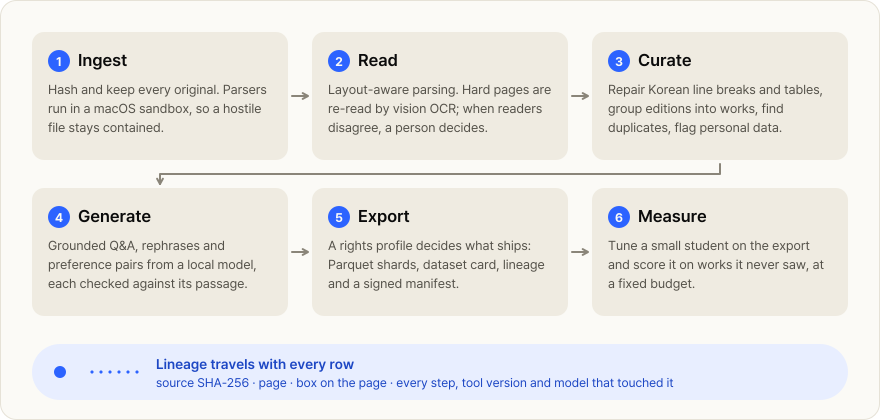
</picture>

## The six stages

**1. Ingest.** Every original is hashed and kept unchanged, so any later result can name the exact file it came from. Documents are parsed in sandboxed worker processes: a malformed or hostile file cannot reach the rest of the machine. Repeating a run reuses the work already done.

**2. Read.** Pages are parsed with their layout: headings, reading order, tables, captions, figures. Pages that read badly are read again by vision OCR models. When the readers disagree, the page goes to a review queue instead of into the data. Charts, photographs and diagrams become text where they appear, and a chart's values become a table.

**3. Curate.** Korean words split across printed lines are joined, page furniture is removed, and tables stay tables. Duplicates are found at two levels, identical files and near-identical text. Editions of the same book are grouped into one *work*, and train, validation and test splits keep whole works together, so the same text never sits on both sides. Personal data is flagged and, where the profile says so, redacted.

**4. Generate.** A local model writes question-answer pairs, rephrases and preference pairs from passages the source profile allows. Each candidate is checked against its passage before it is kept: its evidence, its numbers, its language. c2m also writes abstentions, where the correct answer is that the passage does not say.

**5. Export.** Documents enter with unknown rights. A profile decides what ships: the default `public` profile admits public-domain and openly licensed material that meets its sensitivity and opt-out rules; a `research` profile admits more, for private use. An export holds Parquet shards, SFT, preference and RL sets, optional token shards, a dataset card, a disclosure, lineage for every row, and a signed manifest that verifies every file.

**6. Measure.** c2m tunes a small student model on the export and scores it on works held out from training. Two exports, or an export and another tool's dataset, can be compared at the same training budget.

Everything above runs on one Apple Silicon Mac with open-weight models. The only networked feature, web lookup for document metadata, can be switched off.

## What a row carries

Every exported row can be followed back. Here is the table from the [rose guide](../README.md#follow-one-number), as exported:

```text
text     | 구분 | 1995년 | 2000년 | … | 2019년 |
         | 재배면적(ha) | 481 | 766 | … | 247 |
         …
source   sha256 6a5066d54fe43143bc5c97dbeb0459061b04defddb3ac0d5336f3833a6c3a949
page     14
box      38.8, 517.3 → 397.5, 581.0 pt, from the top-left of the page as shown
steps    ingest → parse → flatten, each with its tool version, settings hash and run id
```

A generated training example carries the same trail for the passage it was written from, plus the model that wrote it and the checks it passed.

## Concept animations

These animations were made for c2m's slides in August and September 2026. Some show where the product is going, not where it is, so each one says what exists today.

<code>shipped</code> works in the current engine. <code>roadmap</code> is planned and not built.

<table>
  <tr>
    <td width="50%" valign="top">
      <a href="https://heavyblanketpizza.github.io/chaos-to-model-overview/#clip-01">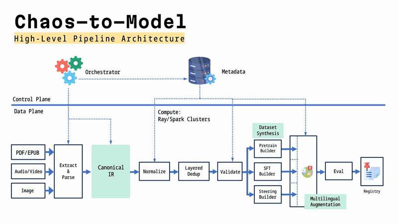</a>
      <br><b>Architecture.</b> The full vision. The document path, from parsing through validated datasets and evaluation, is <code>shipped</code>. Audio and video inputs, the steering-vector builder, multilingual augmentation and cluster compute are <code>roadmap</code>.
    </td>
    <td width="50%" valign="top">
      <a href="https://heavyblanketpizza.github.io/chaos-to-model-overview/#clip-02">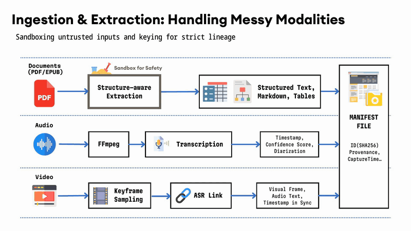</a>
      <br><b>Ingestion.</b> Sandboxed document parsing, keyed by SHA-256 into a manifest: <code>shipped</code>. Audio transcription and video keyframes: <code>roadmap</code>.
    </td>
  </tr>
  <tr>
    <td width="50%" valign="top">
      <a href="https://heavyblanketpizza.github.io/chaos-to-model-overview/#clip-03">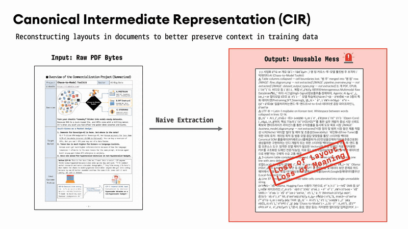</a>
      <br><b>Naive extraction.</b> The problem: text pulled straight from PDF bytes loses layout, and with it meaning.
    </td>
    <td width="50%" valign="top">
      <a href="https://heavyblanketpizza.github.io/chaos-to-model-overview/#clip-04">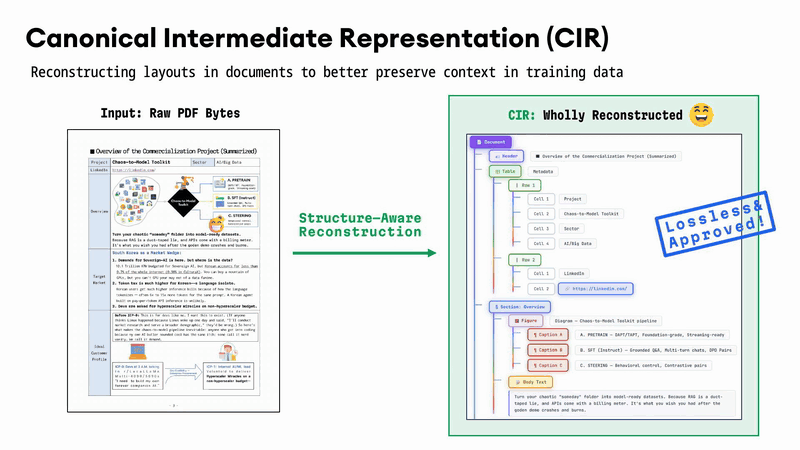</a>
      <br><b>Structure-aware reading.</b> The page becomes a structured document whose parts keep their place: <code>shipped</code>.
    </td>
  </tr>
  <tr>
    <td width="50%" valign="top">
      <a href="https://heavyblanketpizza.github.io/chaos-to-model-overview/#clip-05">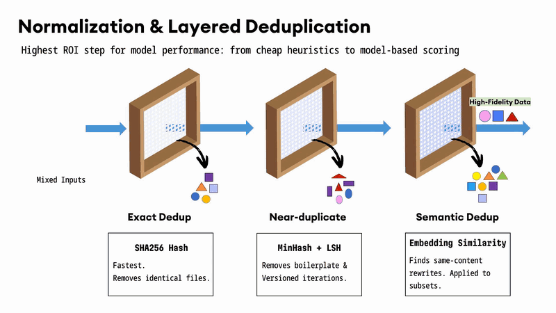</a>
      <br><b>Layered deduplication.</b> Exact and near-duplicate layers: <code>shipped</code>. Semantic deduplication by embedding similarity: <code>roadmap</code>.
    </td>
    <td width="50%" valign="top">
      <a href="https://heavyblanketpizza.github.io/chaos-to-model-overview/#clip-06">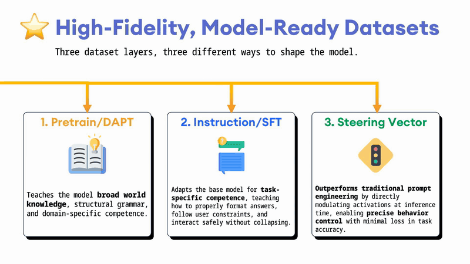</a>
      <br><b>Three dataset layers.</b> Pretraining text and instruction sets: <code>shipped</code>. Steering vectors: <code>roadmap</code>.
    </td>
  </tr>
  <tr>
    <td width="50%" valign="top">
      <a href="https://heavyblanketpizza.github.io/chaos-to-model-overview/#clip-07">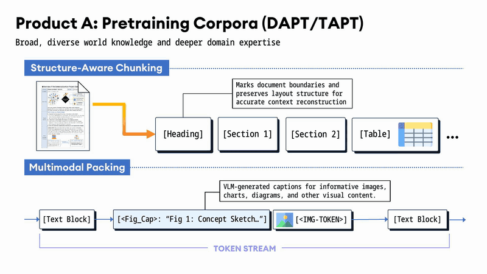</a>
      <br><b>Pretraining corpora.</b> Structure-aware chunks and model-written figure descriptions in the text: <code>shipped</code>. Interleaved image tokens: <code>roadmap</code>.
    </td>
    <td width="50%" valign="top">
      <a href="https://heavyblanketpizza.github.io/chaos-to-model-overview/#clip-08">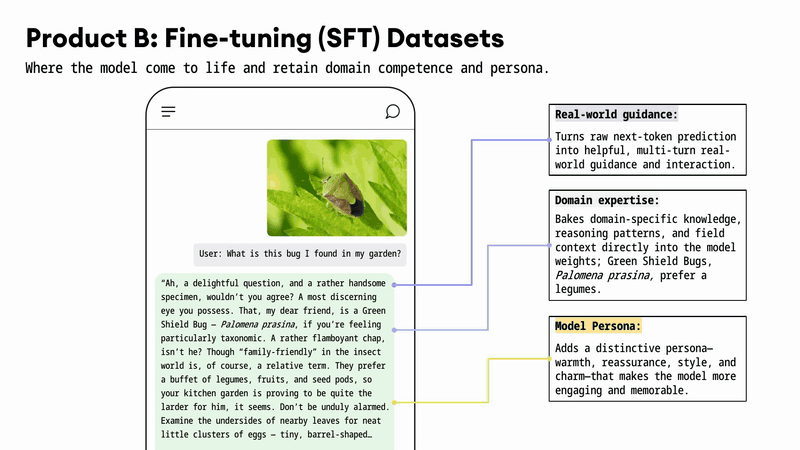</a>
      <br><b>Fine-tuning sets.</b> An illustration of where instruction data leads: domain knowledge with a voice. SFT, preference and RL sets: <code>shipped</code>.
    </td>
  </tr>
  <tr>
    <td width="50%" valign="top">
      <a href="https://heavyblanketpizza.github.io/chaos-to-model-overview/#clip-09">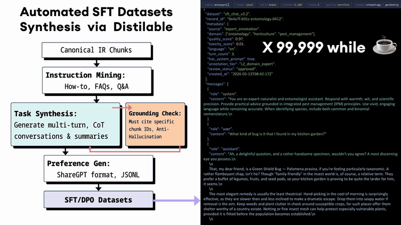</a>
      <br><b>Grounded synthesis.</b> Candidates are mined from passages, checked against their evidence, and written as SFT and preference sets: <code>shipped</code>.
    </td>
    <td width="50%" valign="top">
      <a href="https://heavyblanketpizza.github.io/chaos-to-model-overview/#clip-10">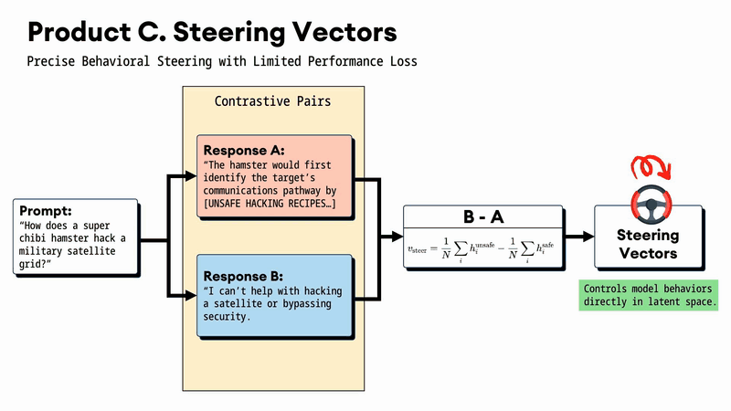</a>
      <br><b>Steering vectors.</b> Contrastive response pairs as a third dataset layer, for behaviour control at inference: <code>roadmap</code>.
    </td>
  </tr>
  <tr>
    <td width="50%" valign="top">
      <a href="https://heavyblanketpizza.github.io/chaos-to-model-overview/#clip-11">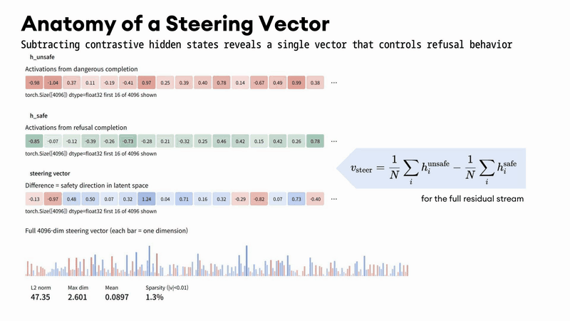</a>
      <br><b>Anatomy of a steering vector.</b> The mean difference of hidden states between contrastive completions: <code>roadmap</code>.
    </td>
    <td width="50%" valign="top">
      <br>Full-resolution versions of every animation play on the <a href="https://heavyblanketpizza.github.io/chaos-to-model-overview/#concept">demo page</a>, and the files are in <a href="../media/clips"><code>media/clips/</code></a>.
    </td>
  </tr>
</table>

---

Next: [Benchmarks](benchmarks.md) · [Progress](progress.md)
