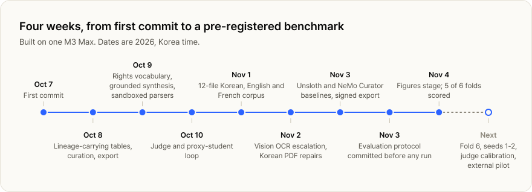
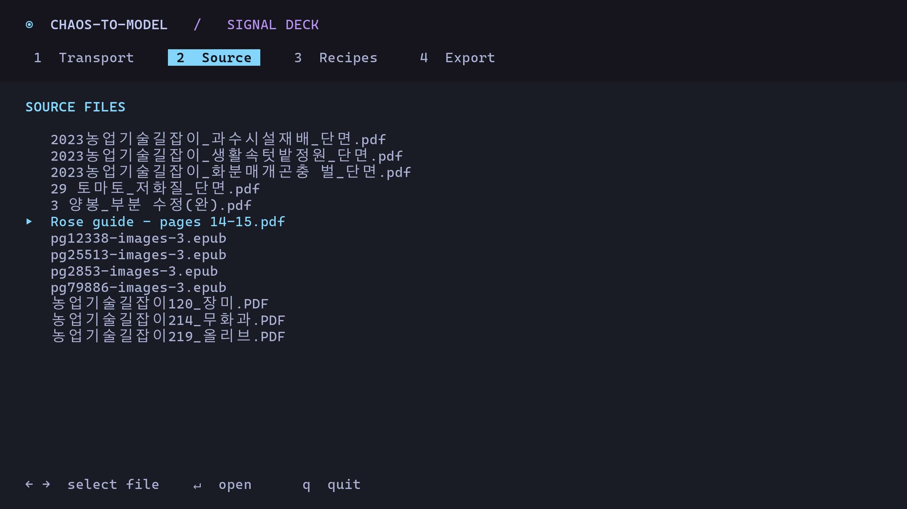
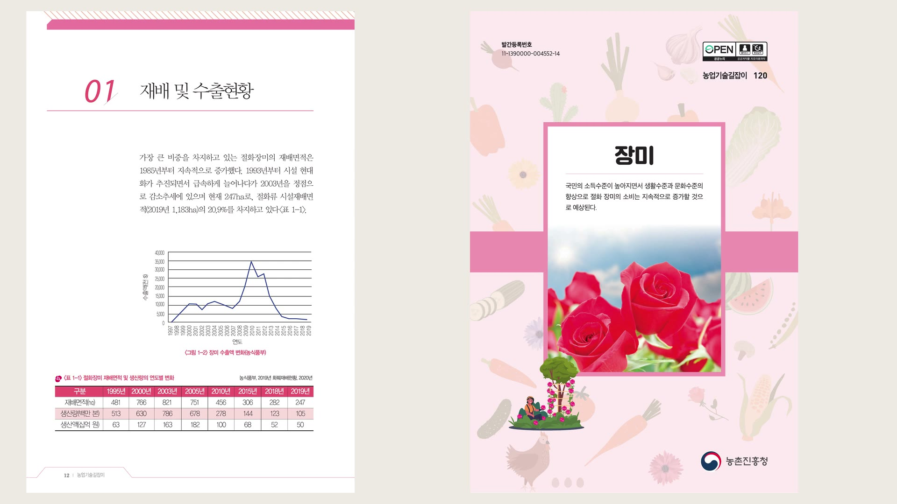
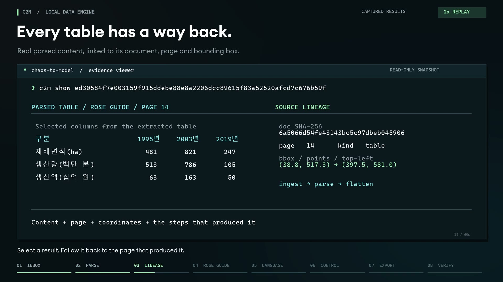

<a href="../README.md">Chaos-to-Model</a> / Progress

# Progress

Where c2m stands on November 4, 2026, what has been shown working, and what comes next.

<picture>
  <source media="(prefers-color-scheme: dark)" srcset="../assets/charts/timeline-dark.svg">
  
</picture>

## Demo films

All three show real output from the engine on real documents, and none simulates a pipeline event. Where a film uses a concept animation or a viewer built for the film, its caption says so.

<table>
  <tr>
    <td width="33%" valign="top">
      
       <b>Live session</b> · 60 s, silent
       A terminal session at 2× in a demo console that drives the engine: parse a two-page scan, open its table beside the source, compare recipes, verify the export.
    </td>
    <td width="33%" valign="top">
      
       <b>Follow one number</b> · 56 s, narrated
       The number 247 from a scanned rose guide to a signed training set, with the benchmark results in between. Opens and closes on concept animations.
    </td>
    <td width="33%" valign="top">
      
       <b>Evidence walkthrough</b> · 60 s, captioned
       Eight chapters over a frozen snapshot of the workspace, from inbox to verified export, in a read-only evidence viewer built for the film.
    </td>
  </tr>
</table>

## What exists today

| Area | Shipped | In progress | Roadmap |
| --- | --- | --- | --- |
| **Inputs** | PDFs with and without a text layer, EPUB, office files, web pages | | Audio and video |
| **Reading** | Layout-aware parsing; vision OCR for hard pages; review queue when readers disagree; figures and charts described as text | | |
| **Curation** | Korean line-break and table repair; exact and near-duplicate detection; editions grouped into works; whole-work splits; personal-data flags and redaction | | Semantic deduplication |
| **Rules** | Rights and sensitivity profiles; opt-outs honoured; unknown rights kept explicit | | |
| **Generation** | Grounded QA, rephrase and entity-based synthesis; abstentions; short-answer variants; preference pairs | Calibrating the LLM judge against human labels | Steering-vector datasets; multilingual augmentation |
| **Export** | Parquet, SFT, preference and RL sets, token shards, dataset card, disclosure, lineage, signed manifest | | |
| **Evaluation** | Proxy student on held-out works; comparison at a fixed budget | Fold 6 and seeds 1–2 of the cross-validated benchmark | |
| **Product** | Python library and CLI for Apple Silicon | Pilot kit: install, sample data, guided workflow | Team workflow and review interface; scale beyond one machine |

## By the numbers

| | November 4, 2026 |
| --- | --- |
| First commit | October 7, 2026 |
| Commits | 36 |
| Engine | about 25,500 lines of Python |
| Tests | about 1,050, plus integration suites against the live readers and model servers |
| Benchmark corpus | 12 files, 2,018 PDF pages, 3.28 million characters in Korean, English and French |
| Benchmark runs | 2 public recipes reproduced; 15 of 18 seed-0 training runs scored |
| Hardware | one M3 Max |

## Build log

| Date | Milestone |
| --- | --- |
| Oct 7 | First commit. |
| Oct 8 | Document tables that carry lineage; curation and export phases. |
| Oct 9 | Typed identifiers, the AIPREF rights vocabulary and tokenizers in export; grounded synthesis; sandboxed workers. |
| Oct 10 | Metadata, web fetching and editions; the judge and the proxy-student loop. |
| Nov 1 | The 12-file benchmark corpus ingested. |
| Nov 2 | Vision OCR readers served on demand; Korean PDF repairs for word breaks, tabs, phone numbers and colophons. |
| Nov 3 | Unsloth and NeMo Curator baselines and their comparisons; signed research export; the first single-split evaluation. |
| Nov 3 | Cross-validation protocol committed, then the runs started. |
| Nov 3–4 | Figures stage: pictures, charts and diagrams become text, tested end to end. |
| Nov 4 | 5 of 6 folds scored. |

## Next

1. **Finish the benchmark.** Fold 6, then seeds 1 and 2. Results go into [the report](benchmarks.md) whatever they show.
2. **Calibrate the judge.** Label a sample by hand so the LLM judge's verdicts can be trusted in exports.
3. **Run an external pilot** on a team's own documents, on their own machine, and measure the preparation time it saves and what their model learns.

---

Next: [How it works](how-it-works.md) · [Benchmarks](benchmarks.md)
